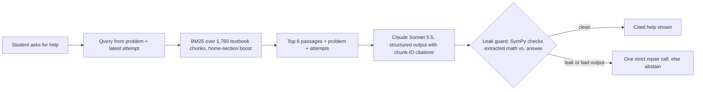

# Calculus Tutor

As a student and tutor, I often saw LLMs fail students learning mathematics. They tend to give
too much away, which takes the understanding out of the student's hands. This project builds a
tutor that holds back: prompt engineering, hard-coded limits, symbolic answer checking, RAG over
OpenStax's *Calculus Volume 1* (textbook-grounded hints), and, next, LoRA fine-tuning on
tutoring data scored with TutorBench's human-written rubrics.[^ai]

**Live:** <https://tutor.thomasgragossian.dev> · **Status:** practice loop live since 2026-10-21;
AI help live as a **beta** since 2026-11-06 (Claude Sonnet 5.5), with every missed target below.

<!-- TODO: 20-second GIF: wrong derivative → "What did I do wrong?" → cited help -->

## What it does

- **Practice** on derivatives (basic rules, trig, chain rule): 22 reviewed problems, math input
  with MathLive, answers graded by a SymPy checker that *proves* equivalence or abstains.
- **Help** when stuck: *Hint* (a ladder that gets more direct each time), *What did I do wrong?*
  and *Explain this*. Every delivered response cites the OpenStax passages it used.
- **Answer containment:** a leak guard checks the math in each response against the reference
  answer before the student sees it, and blocks or abstains on a match. *Show answer* (two
  clicks, with a warning) is the only intended answer path.

## How a hint is made



The server sets how much help may reveal: before a wrong answer the tutor asks about the
problem's form; after one, the mistake type (algebra, wrong rule, misapplied, incomplete) picks its ladder.

## Design decisions and why

| Decision | Why |
|---|---|
| BM25, not embeddings (yet) | Small closed corpus; keyword match on math vocabulary is cheap, reproducible and fits a 1 GB host. Embeddings are a measured upgrade, not a default. |
| Own chunk IDs as citations | Citations are checked against what was retrieved, so the model cannot cite a passage it never saw. |
| Server-owned hint levels | The model writes the text; code decides how much it may reveal. |
| A guard that can say no | Prompting alone does not stop leaks; a symbolic check plus abstention does for supported math. |
| Sonnet over Haiku, by measurement | Same harness, blind audit: Sonnet 31/36 useful and 5/6 correct abstentions vs Haiku 25/36 and 2/6, at about 1.4¢ vs 0.1¢ a hint. |
| Spend ledger | Each call reserves its worst-case cost first, with per-user limits and a monthly cap. |

## Evaluation

Each part is measured on hand-reviewed dev sets, then once on a held-out set (behavior, not learning gains).

| Component | Result | Set |
|---|---|---|
| Answer checker | 0 false accepts (of 50 wrong), 0 false rejects (of 49 right) | [136 dev cases](evals/verifier/results/dev-b.md) |
| Retrieval, Recall@6 / Hit@6 | dev 0.774 / 0.964; holdout **0.722** / 0.833 (target 0.80) | 28 dev, 12 holdout queries |
| Help: answer leaks | **0 of 66** responses (dev and holdout) | 42 dev, 24 holdout cases |
| Help: holdout, Sonnet | math errors 0/17, citations supported 17/17, correct abstentions 3/4, **useful 12/20** (target 70%), good help blocked by the guard **7/23** (target ≤ 15%), p95 7.1 s | [holdout summary](evals/help/results/20261106-005314-holdout/summary.md) |
| Judge vs my labels | agreed on 136/138 random dev labels and 48/48 holdout labels | blind audit |

**How help is scored.** A blind AI judge scores each response against [my rubric](evals/help/rubric/v2.md);
I audit a random 20% plus every flagged response without seeing the model, and my labels win.
Gates were fixed before results and the holdout ran once; misses are reported, not tuned away
(a draft holdout retrieval score was seen before the final labeling rule).

**What the misses say.** Even the stronger model needs retrieval, a guard and an audit, and still
falls short on usefulness: the gap fine-tuning targets. Live testing found the prompt let it coach
an *earlier* attempt; that fix (R40) shipped after the holdout, re-checked on dev only.

## What's next

1. **Fine-tuned open model:** QLoRA on Qwen 9B, compared with Claude on this harness, an untouched
   test set and TutorBench Calculus; aiming for lower cost at equal or better quality.
2. **Pre-written explanations:** generate the 18 *Explain this* answers once, review them, and
   serve them from storage: no model call, no latency, no over-helping.
3. **Retrieval and guard:** pin worked examples for "how do I…" queries; stop blocking f(x)g(x)-style formulas.
4. **With real users:** A/B test hint styles on solve rate after help, not just ratings.
5. **Exam prep:** course materials and an exam date in; weak spots, a study plan and problem sets out.

## Stack and running locally

Python · FastAPI · SQLAlchemy/Alembic · SymPy · Anthropic API · MathLive · Docker Compose with
Caddy on AWS Lightsail (1 GB) · Cloudflare DNS; 1,648 Python and 49 web tests in CI. Help needs
`MATHTUTOR_ANTHROPIC_API_KEY`; without it practice works and help is hidden ([setup](docs/ops/local.md)).

```bash
cp deploy/.env.example deploy/.env    # set MATHTUTOR_SECRET_KEY and SITE_ADDRESS=localhost
docker build -t mathtutor:local . && docker compose -f deploy/compose.yaml up -d
```

## For reviewers

Detail in [`docs/`](docs/README.md): [decisions](docs/decisions/), [help evaluation](evals/help/README.md),
[C1 rulings](docs/superpowers/plans/portfolio-mvp/milestone-c/c1/21-rulings.md), [tuning list](docs/superpowers/plans/portfolio-mvp/milestone-c/c1/22-tuning.md),
[reviews](docs/reviews/README.md), [handoff](handoff.md). Textbook: *Calculus Volume 1*, Strang and
Herman, OpenStax, CC BY-NC-SA 4.0.

[^ai]: Planning and technical review were assisted by Anthropic Claude and OpenAI Codex.
