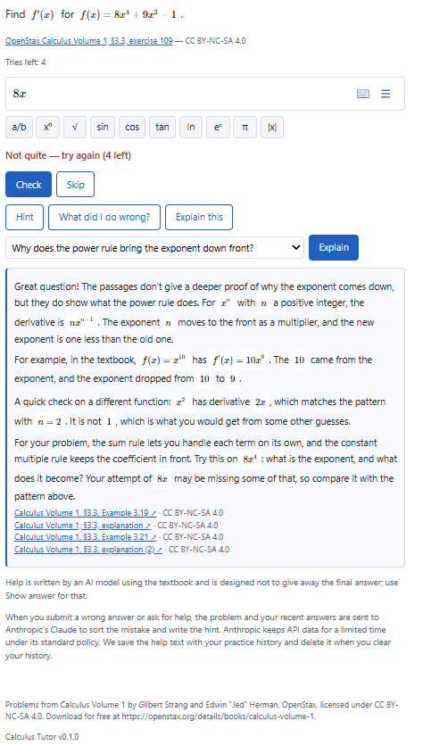
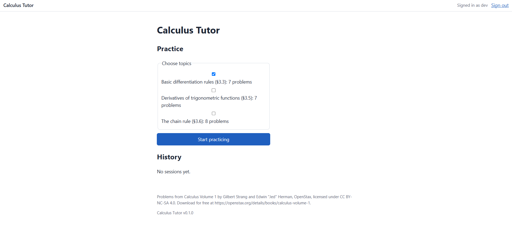
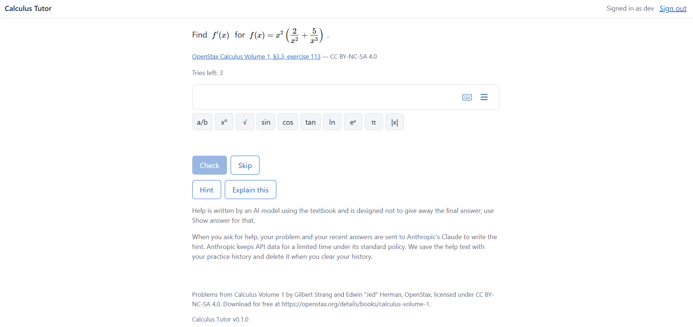
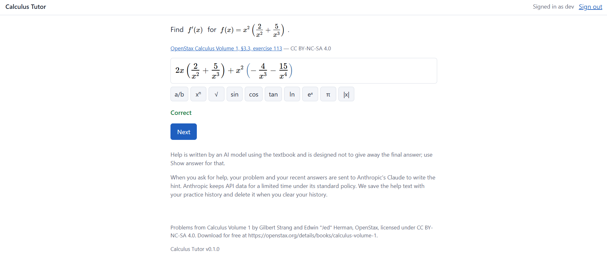
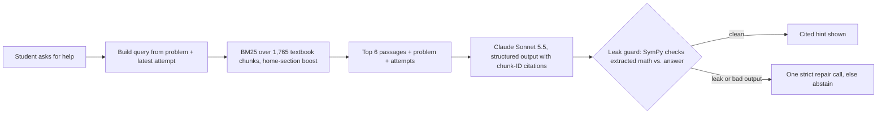

# Calculus Tutor

## Why this exists

As a student and tutor, I have seen students ask an LLM for a hint and receive a complete
solution instead. The answer may help with today's homework while leaving the student less
prepared to solve the next problem alone. In a [high-school math experiment](https://pmc.ncbi.nlm.nih.gov/articles/PMC12232635/),
students using an unrestricted AI tutor did better during practice but worse on an exam
without AI; a version constrained to teacher-designed hints avoided that drop.

AI use is already common: a [study of 95,513 undergraduates](https://cshe.berkeley.edu/news/study-finds-widespread-generative-ai-use-among-college-students-signaling-urgent-need)
at 20 public research universities found that 53% of students in mathematics used
generative AI at least monthly. Separately, [UC San Diego's mathematics department](https://math.ucsd.edu/about/chair-statement-math-preparedness)
reports declining preparation among incoming students and lists widely available AI among
several possible contributors. UC Berkeley mathematics professor [Zvezdelina Stankova](https://sfstandard.com/opinion/2026/08/15/uc-berkeley-sat-test-blind-admissions-math-scores/)
has described some students as five to eight years behind in math. Together, these sources
show widespread AI use and serious preparedness concerns; they do not show that AI caused
those preparation gaps.

Calculus Tutor is my attempt to steer students toward using AI as support while they do
the mathematical work themselves. Students enter their own answers, and a symbolic checker
grades what it can prove. The server controls how direct each hint can be, grounds help in
OpenStax, and checks supported mathematical answer forms for leaks before showing a reply.
These guardrails make the tutor harder to use as an answer machine and encourage students
to reason through the next step instead of repeating an LLM's solution. Current evaluations
measure hint usefulness and leaks, not learning gains; a TutorBench-guided LoRA experiment
is planned. Independent assessments, including in-person exams, still matter for judging
what a student can do unaided.

All code was written by AI agents under my direction
([how this was built](#how-this-was-built)).

**Live:** <https://tutor.thomasgragossian.dev> · **Status:** practice loop live since
2026-10-21; AI help live as a **beta** since 2026-11-05 (Claude Sonnet 5.5).

<p align="center">
  
</p>

## What it does

- **Practice** on derivatives (basic rules, trig, chain rule): 22 reviewed problems, math
  input with MathLive, answers graded by a SymPy checker that *proves* equivalence or abstains.
- **Help** when stuck: *Hint* (a ladder that gets more direct each time), *What did I do
  wrong?* and *Explain this*. Every response cites the OpenStax passages it used, given it did
  not abstain from responding.
- **Answer containment:** a leak guard checks supported math in each response against the
  reference answer before the student sees it. If it detects an answer in the output for the
  student, the tutor blocks the response or abstains. *Show answer* is the intended answer path.

| Choose topics | Enter an answer | Checked symbolically |
|---|---|---|
|  |  |  |

## How a hint is made



The help ladder is set by the server, not the model: before any wrong answer the tutor asks a
question about the problem's form; after one, it labels the mistake (algebra slip, wrong
rule, rule misapplied, incomplete) and climbs a separate ladder per mistake type.

## How RAG works

Generated help draws on OpenStax definitions, rules and worked examples, with citations to
the source sections. The tutor abstains when it cannot provide supported help.

**Building the corpus.** A fetch script downloads *Calculus Volume 1* from OpenStax's archive
(polite, one request per second, pinned to a book version). The pages carry math only as
MathML, so I wrote a MathML-to-LaTeX converter; all 18,058 math elements convert with none
lost. The builder splits each section into chunks of about 300–500 tokens along the book's own
structure (prose under one heading, a definition box, a theorem, a worked example), keeping
each display equation with its lead-in sentence. Each chunk gets a stable ID such as
`c1-3.3-ex2`, a role (definition, theorem, rule, example, explanation, exercise, answer key)
and its section URL. The result is 1,765 chunks, hashed so that if the corpus was edited or
corrupted, the app turns help off instead of citing it.

**Retrieval.** Search is BM25, written from scratch in pure Python and held in memory by the
web process. The tokenizer is tuned for math text: it keeps LaTeX commands like `\sin` and
`\ln` as terms, turns `f''` into two "prime" tokens, maps `\sin^{-1}` to arcsin and `e^x` to
"exponential", and folds accents so "L'Hôpital" matches "LHopital". The query is built from
the problem statement and topic, plus the student's latest wrong attempt (for *What did I do
wrong?*) or the confusion they picked (for *Explain this*). Chunks from the problem's own
section get a 1.3× score boost, and the top 6 are kept.

**Keeping the answer out of the passages.** The practice problems are themselves textbook
exercises, so retrieval only searches teaching text (definitions, theorems, rules, examples,
explanations). Exercises and the answer key are never searched. The passage filter checks
supported mathematical forms of the problem's answer and drops matches before generation.
If no passages are left, the tutor abstains rather than answering without a source.

**Using the passages.** The model gets the passages with their chunk IDs and must return
structured output naming the IDs it used. The server rejects any citation that was not in
this request's retrieved set, so the model cannot invent a source. The student sees each
citation as a link to the exact OpenStax section.

**Measuring it.** I hand labeled which chunks are relevant for 28 development and 12 holdout
queries and score retrieval on its own, separately from the model (results below). This shows
whether a weak hint came from a bad search or from the model.

## Design decisions and why

| Decision | Why |
|---|---|
| BM25 first, not embeddings | Small, closed corpus; keyword match on math vocabulary is strong, cheap, reproducible and fits a 1 GB host. Embeddings are a measured upgrade, not a default. |
| Own chunk IDs as citations | Citations are checked against what was actually retrieved, so the model cannot cite a passage it never saw. |
| Server-owned hint levels | The model writes the text; code decides how much it may reveal. Easier to test and tune. |
| A guard that can say no | Prompting alone does not stop answer leaks; a symbolic check plus abstention does for supported math. |
| Sonnet over Haiku, by measurement | Compared on the same cases before choosing: Sonnet gave useful help 31/36 times vs Haiku's 25/36, at about 1.4¢ vs 0.1¢ per hint (to be replaced by a LoRA fine-tuned Qwen model). |
| Spend ledger | Every call reserves its worst-case cost before it runs, with per-user rate limits and a monthly cap, so a bug cannot run up a bill. |

## Evaluation

I measure answer checking, textbook retrieval, and AI help separately: first on development
sets, then once on a held-out set. These tests measure system behavior, not whether students
learn more.

| Component | Result | Who reviewed it |
|---|---|---|
| Answer checker | 0 false accepts among 50 incorrect answers; 0 false rejects among 49 correct answers | Hand reviewed the labels for [136 development cases](evals/verifier/results/dev-b.md); code scored the answers |
| Textbook retrieval | Recall@6: dev 0.774, holdout 0.722 (target 0.80); Hit@6: dev 0.964, holdout 0.833 | Hand labeled 28 dev and 12 holdout queries; code computed the scores |
| AI help, development | Sonnet: 0/42 leaks, 31/36 useful; Haiku: 0/42 leaks, 25/36 useful | AI judge scored every response; I audited a blind sample ([summary](evals/help/results/20261105-232124-dev/summary.md)) |
| AI help, holdout (run once) | Sonnet: 0/24 leaks, 0/17 math errors, 17/17 citations supported, **12/20 useful** (target 70%) | AI judge plus blind audit ([summary](evals/help/results/20261106-005314-holdout/summary.md)) |

**Answer checking.** A false accept marks a wrong answer correct; a false reject marks a correct
answer wrong. Both were zero on the hand-reviewed development cases. That is evidence about
those cases rather than a universal guarantee. If symbolic proof and certified counterexample
checks cannot decide, the checker says *unable to verify* without using a try.

**Retrieval.** Recall@6 is the share of passages hand labeled relevant that appear in the
top six results; Hit@6 asks whether at least one appears there. High Hit@6 can coexist with
lower recall when several passages are relevant: most misses are the extra worked example a
"how do I…" question also deserves. Both splits fall short of the predeclared 0.80 gate.

**AI help.** Hand reviewed the 42 development and 24 holdout cases, which cover hints,
feedback, explanations, mistakes, answer-seeking, and unsupported requests. Haiku and Sonnet
used the same retrieval, prompt, citation checks, and leak guard. A blinded AI judge scores
each response for usefulness, math accuracy, citation support, and leakage against
[my written rubric](evals/help/rubric/v2.md); it cannot see which model produced a response.
My audit is blind to model identity too: I reviewed a stratified random 20% plus every flagged
case, and my labels replace the judge's where I reviewed. The judge agreed with me on 184 of
186 labels.

**Holdout.** After the development decisions, I froze the model and prompt and ran the holdout
once. A draft holdout retrieval score was seen before the final labeling rule, so I do not call
that set entirely uninspected. Missed gates are reported here, not tuned away by rerunning the
same cases. The holdout is small, so the linked summaries give counts and uncertainty intervals
alongside percentages. The guard also blocked 7 of 23 good responses (target at most 15%).
One prompt fix found by testing the live site was committed after the holdout; its deployment
is not yet confirmed. The holdout numbers describe the earlier prompt.

## What's next

**In progress: answer history and a mistake-driven hint ladder.** Each answer becomes one
database row with its owner, attempt number, verdict and mistake type. A fast model labels
every wrong answer as an algebra slip, wrong rule, rule misapplied or incomplete, and each
repeat of the same mistake makes the next hint more direct. The tutor gives one hint per
attempt: one to get started, then one for each wrong answer. Extra clicks get a short prompt
to try again, so the ladder moves only when the student does. A student who is missing the
concept uses *Explain this*, which walks through how this kind of problem is done; one who
knows the direction but finds the problem hard climbs the ladder by trying. Students get five
tries instead of three. [Design and plan](docs/superpowers/plans/2026-11-05-answers-table/README.md).

1. **Baseline comparison (planned).** On the same fresh cases, compare a plain LLM request,
   a paste-in tutoring prompt, the tutor without retrieval, and the full textbook-grounded
   tutor. Use one model and rubric; report useful help, answer leaks, math errors, latency,
   and cost per useful hint. No paid comparison result is available yet.
2. **Fine-tuning experiment: LoRA vs QLoRA on open models.** I plan to compare LoRA and QLoRA
   fine-tuning on open Qwen models at roughly 9B and 27B parameters, benchmarked with
   TutorBench's human-written rubrics. The aim is cheaper tutoring help that matches or beats
   the Claude baseline.
   - **Comparison:** each size trained both ways (LoRA, and QLoRA on a 4-bit base), then
     compared on help quality, answer leaks, cost per hint, GPU memory and latency. The 9B
     comparison comes first; 27B follows if 9B falls short.
   - **Benchmarks:** TutorBench Calculus (258 expert tasks with per-task rubrics), this
     project's evaluation harness and a new untouched test set (the C1 holdout has already
     been used once).
   - **Shipping rule, set before training:** a fine-tuned model replaces Claude only with zero
     observed leaks and usefulness within a predeclared margin of the Claude baseline, at a
     lower cost per hint. Otherwise I report the result and keep Claude.
   - **Data:** training uses TutorBench's non-calculus tasks (several generated responses per
     task, scored against its rubrics) and Eedi tutoring dialogues. Evaluation data is never
     trained on, and the weights are not published
     ([decision 0005](docs/decisions/0005-tutoring-datasets-and-fine-tuning.md)).
   - **Infrastructure:** training on AWS GPUs (SageMaker training jobs or EC2 spot), serving
     off this host on a serverless GPU.
3. **Retrieval and guard:** pin a worked example for "how do I…" questions (most current
   misses), and stop the guard blocking general formulas such as f(x)g(x).
4. **Pre-written explanations:** generate the 18 *Explain this* answers once, review them by
   hand, and serve them with no model call.
5. **With real users:** A/B test hint styles (e.g. how much the first hint gives) on solve rate
   after help, not just ratings.
6. **Exam/Quiz prep, personalized:** students can input course learning materials for tuned
   help for quizzes and exams. The tutor gives quizzes to find weaknesses and creates high-value
   problem sets. Students can also say how long they have before their exam and how many hours
   they can commit to the learning process.

## How this was built

All of the code was written by AI coding agents: Anthropic's Claude wrote it, and OpenAI's
Codex reviewed it. My part was everything around the code: the problem and goals, the design
choices and limits, the 22 reviewed problems, the hand-labeled evaluation sets, the blind
audits of the AI judge, the usefulness standards and the release decisions, including
reporting the missed targets above rather than tuning them away.

## Stack

Python · FastAPI · SQLAlchemy/Alembic · SymPy · Anthropic API · MathLive · Docker Compose
with Caddy on AWS Lightsail (1 GB) · Cloudflare DNS. Python and web test suites run in CI.

## Run locally

```bash
cp deploy/.env.example deploy/.env    # set MATHTUTOR_SECRET_KEY and SITE_ADDRESS=localhost
docker build -t mathtutor:local . && docker compose -f deploy/compose.yaml up -d
```

Details: [local setup](docs/ops/local.md).
Help needs `MATHTUTOR_ANTHROPIC_API_KEY`; without it, practice works and help is hidden.

## For reviewers

Engineering detail lives in [`docs/`](docs/README.md): [decisions](docs/decisions/),
[help evaluation](evals/help/README.md), [verifier results](evals/verifier/results/dev-b.md),
[code reviews](docs/reviews/README.md) and the [handoff](handoff.md) with current status.

Textbook content: *Calculus Volume 1* by Gilbert Strang and Edwin "Jed" Herman, OpenStax,
CC BY-NC-SA 4.0. Planned benchmark and training data: TutorBench (Scale AI; Srinivasa et al.,
2025; paper CC BY-NC-ND 4.0) and Eedi Question-Anchored Tutoring Dialogues (CC BY-NC-SA 4.0).
