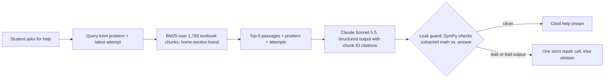

# Calculus Tutor

As a student and tutor, I often saw LLMs fail students learning mathematics. They tend to give
too much away, which takes the understanding out of the student's hands. This project builds a
tutor that holds back: prompt engineering, hard-coded limits, symbolic answer checking, RAG over
OpenStax's *Calculus Volume 1* (textbook-grounded hints), and, next, LoRA fine-tuning on
tutoring data scored with TutorBench's human-written rubrics.[^ai]

**Live:** <https://tutor.thomasgragossian.dev> · **Status:** practice loop live since 2026-10-21;
AI help live as a **beta** since 2026-11-06 (Claude Sonnet 5.5), with every missed target below.

<!-- TODO: 20-second GIF: wrong derivative → "What did I do wrong?" → cited help -->

## What it does

- **Practice** on derivatives (basic rules, trig, chain rule): 22 reviewed problems, math input
  with MathLive, answers graded by a SymPy checker that *proves* equivalence or abstains.
- **Help** when stuck: *Hint* (a ladder that gets more direct each time), *What did I do wrong?*
  and *Explain this*. Every response cites the OpenStax passages it used, unless it abstains.
- **Answer containment:** a leak guard checks the math in each response against the reference
  answer before the student sees it. If it detects the answer, the tutor blocks the response
  or abstains. *Show answer* (two clicks, with a warning) is the only intended answer path.

## How a hint is made



The help ladder is set by the server, not the model. Before any wrong answer the tutor asks a
question about the problem's form, without naming the rule; asked again, it names the rule.
After a wrong answer, the model labels the mistake (algebra slip, wrong rule, rule misapplied,
incomplete) and each type climbs its own ladder, from a gentle nudge to a walkthrough that
stops before the answer.

## Design decisions and why

| Decision | Why |
|---|---|
| BM25 first, not embeddings | Small, closed corpus; keyword match on math vocabulary is strong, cheap, reproducible and fits a 1 GB host. Embeddings are a measured upgrade, not a default. |
| Own chunk IDs as citations | Citations are checked against what was actually retrieved, so the model cannot cite a passage it never saw. |
| Server-owned hint levels | The model writes the text; code decides how much it may reveal. Easier to test and tune. |
| A guard that can say no | Prompting alone does not stop answer leaks; a symbolic check plus abstention does for supported math. |
| Sonnet over Haiku, by measurement | Same retrieval, prompts, citation checks and guard, compared before choosing: Sonnet 31/36 useful and 5/6 correct abstentions vs Haiku 25/36 and 2/6, at about 1.4¢ vs 0.1¢ a hint. A fine-tuned Qwen model is meant to replace both. |
| Spend ledger | Every call reserves its worst-case cost before it runs, with per-user rate limits and a monthly cap, so a bug cannot run up a bill. |

## Evaluation

I measure answer checking, textbook retrieval and AI help separately: first on hand-reviewed
development sets, then once on a held-out set. These tests measure system behavior, not whether
students learn more.

| Component | Result | Who reviewed it |
|---|---|---|
| Answer checker | 0 false accepts among 50 incorrect answers; 0 false rejects among 49 correct answers | I hand reviewed the labels for [136 development cases](evals/verifier/results/dev-b.md); code scored the answers |
| Textbook retrieval | Recall@6: dev 0.774, holdout **0.722** (target 0.80); Hit@6: dev 0.964, holdout 0.833 | I hand labeled 28 dev and 12 holdout queries; code computed the scores |
| AI help, development | Sonnet: 0/42 leaks, 31/36 useful, 5/6 correct abstentions; Haiku: 0/42 leaks, 25/36 useful, 2/6 | An AI judge scored every response; I audited 31 of them blind ([summary](evals/help/results/20261105-232124-dev/summary.md)) |
| AI help, holdout (once) | Sonnet: 0/24 leaks, 0/17 math errors, 17/17 citations supported, 3/4 correct abstentions, **12/20 useful** (target 70%), **7/23** good responses blocked by the guard (target ≤ 15%), p95 7.1 s | Judge-scored, 8 rows audited blind ([summary](evals/help/results/20261106-005314-holdout/summary.md)) |
| Judge vs my labels | Agreed on 136 of 138 labels in the random dev sample and 48 of 48 on the holdout | The audit itself |

**Answer checking.** A false accept marks a wrong answer correct; a false reject marks a correct
answer wrong. Both were zero on the hand-reviewed development cases. That is evidence about
those cases rather than a universal guarantee. If symbolic proof and certified counterexample
checks cannot decide, the checker says *unable to verify* without using a try.

**Retrieval.** Recall@6 is the share of hand-labeled relevant passages that appear in the top
six results; Hit@6 asks whether at least one appears there. High Hit@6 can coexist with lower
recall when several passages are relevant: most misses are the extra worked example or
explanation that a "how do I…" question also deserves. Both splits fall short of the
predeclared 0.80 gate.

**AI help.** I hand reviewed the 42 development and 24 holdout cases, which cover hints,
feedback, explanations, known mistakes, answer-seeking and requests the textbook cannot
support. Haiku and Sonnet used the same retrieval, prompts, citation checks and leak guard. A
blind AI judge scores each response against [my written rubric](evals/help/rubric/v2.md) for
leaks, accuracy, citation support and usefulness; it cannot see which model produced a
response. My audit is blind to model identity too: a stratified random 20% plus every flagged
response. For rows I review, my labels replace the judge's; other rows keep the judge's. Rubric
v2 adds two usefulness standards I set during the development audit (confusing or
self-contradicting help is not useful; *Explain this* must not set up the student's own problem).

**Holdout.** After the development decisions I froze the model and prompt and ran the holdout
once, with Sonnet only. A draft holdout retrieval score was seen before the final labeling rule,
so I do not call that set entirely uninspected. Missed gates are reported here, not tuned away
by rerunning the same cases. The set is small, so the linked summaries give counts and 95%
uncertainty intervals alongside the percentages.

**What the misses say.** Even the stronger model needs retrieval, a guard and a human audit to
tutor well, and it still falls short on usefulness; that gap is what the fine-tuning step
targets. Testing the live site as a student also found that the prompt let the model coach an
*earlier* attempt when there were several. That fix (ruling R40) shipped after the holdout and
was re-checked on development cases only, so the holdout numbers describe the earlier prompt.

## What's next

1. **Fine-tuned open model:** QLoRA on Qwen 9B for tutoring, served on RunPod, compared with
   the Claude baseline on this harness, a separate untouched test set and TutorBench Calculus.
   The aim is lower serving cost while maintaining or improving help quality.
2. **Pre-written explanations:** generate the 18 *Explain this* answers once, review them by
   hand, and serve them from storage: no model call, no latency, no over-helping.
3. **Retrieval and guard:** pin a worked example for "how do I…" questions (most current recall
   misses), and stop the guard blocking general formulas such as f(x)g(x).
4. **With real users:** A/B test hint styles (e.g. how much the first hint gives) on solve rate
   after help, not just ratings. Ratings and a complete Clear history come in C2.
5. **Exam and quiz prep, personalized:** students add course materials, how long they have
   before an exam and how many hours they can commit; the tutor quizzes them to find weak spots
   and builds high-value problem sets and a study plan around that time.

## Stack

Python · FastAPI · SQLAlchemy/Alembic · SymPy · Anthropic API · MathLive · Docker Compose with
Caddy on AWS Lightsail (1 GB) · Cloudflare DNS. 1,648 Python tests and 49 web tests in CI.

## Run locally

```bash
cp deploy/.env.example deploy/.env    # set MATHTUTOR_SECRET_KEY and SITE_ADDRESS=localhost
docker build -t mathtutor:local . && docker compose -f deploy/compose.yaml up -d
```

Details: [local setup](docs/ops/local.md). Help needs `MATHTUTOR_ANTHROPIC_API_KEY`; without
it, practice works and help is hidden.

## For reviewers

Engineering detail lives in [`docs/`](docs/README.md): [decisions](docs/decisions/),
[help evaluation](evals/help/README.md), [verifier results](evals/verifier/results/dev-b.md),
[C1 rulings](docs/superpowers/plans/portfolio-mvp/milestone-c/c1/21-rulings.md),
[tuning list](docs/superpowers/plans/portfolio-mvp/milestone-c/c1/22-tuning.md),
[code reviews](docs/reviews/README.md) and the [handoff](handoff.md) with current status.

Textbook content: *Calculus Volume 1* by Gilbert Strang and Edwin "Jed" Herman, OpenStax,
CC BY-NC-SA 4.0.

[^ai]: Planning and technical review were assisted by Anthropic Claude and OpenAI Codex.
